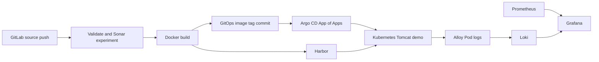

# GitLab GitOps Lab

GitLab CI, Harbor, Argo CD로 컨테이너 빌드와 GitOps 배포를 연결하고, Prometheus·Grafana·Alloy·Loki로 메트릭과 로그를 수집·조회한 **개인 PoC**입니다.

이 저장소는 개인 GitLab 프로젝트를 채용 포트폴리오로 소개하기 위해 정리한 공개용 사본입니다. 기존 클러스터의 주소와 프로젝트 식별자는 예시 값으로 바꿨습니다. GitHub는 코드 열람용이며, 이 사본을 올리는 것만으로 원본 GitLab 파이프라인이나 Argo CD가 GitHub로 이전되지는 않습니다.

## 먼저 볼 구현

| 확인할 내용 | 코드 |
|---|---|
| 경로별 pipeline/job 실행 조건, 이미지 빌드와 GitOps 변경 | [.gitlab-ci.yml](.gitlab-ci.yml) |
| App of Apps 진입점과 child Applications | [root](k8s-gitops/root/root-application.yaml), [applications](k8s-gitops/applications) |
| HPA와 GitOps의 replicas 관리 분리 | [Application](k8s-gitops/applications/api-tester-dev.yaml), [Deployment](k8s-gitops/apps/api-tester/base/deployment.yaml), [HPA](k8s-gitops/apps/api-tester/base/hpa.yaml) |
| Pod 로그 탐색·라벨링과 Loki 전송 | [Alloy values](k8s-gitops/addons/logging/alloy/values.yaml) |
| 메트릭·로그 저장 구성 | [Prometheus/Grafana](k8s-gitops/addons/monitoring/kube-prometheus-stack/values.yaml), [Loki](k8s-gitops/addons/logging/loki/values.yaml) |
| Gateway·HTTPRoute 구성 | [Gateway](k8s-gitops/addons/nginx-gateway), [app HTTPRoute](k8s-gitops/apps/api-tester/overlays/dev/httproute.yaml) |

## 구성 흐름

## 직접 구현한 범위

- `api-tester` 변경을 이미지 빌드·Harbor push·dev overlay 태그 갱신으로 연결했습니다. GitLab CI는 Git을 갱신하고 Argo CD가 클러스터 반영을 담당합니다.
- 자동 배포 commit의 제목 패턴을 workflow에서 제외해 pipeline 재생성을 차단했습니다.
- 앱 Deployment에서 replicas를 생략하고 HPA가 개수를 관리하도록 구성했습니다. Argo CD의 `ignoreDifferences`와 `RespectIgnoreDifferences`를 함께 설정했습니다.
- Prometheus/Grafana와 Alloy/Loki의 Helm wrapper chart 및 Argo CD Application을 구성했습니다.
- 개인 실습에서 메트릭·로그 조회, Docker client와 worker containerd의 Harbor CA 신뢰 설정을 통한 이미지 pull 문제 해결을 확인했습니다. 이 사본에 당시 로그·스크린샷은 포함하지 않았습니다.

## 해석할 때 주의할 점

- 앱은 Tomcat의 정적 HTML 배포 예제입니다. 업무 API나 자동 API 테스트 도구를 구현한 프로젝트는 아닙니다.
- Sonar job은 `allow_failure: true`입니다. 실패해도 뒤 단계가 진행되는 실험이며, 품질 검사로 배포를 차단한 성과는 아닙니다. 대시보드에서 실제 취약점이 검출됐는지는 이 코드만으로 입증하지 않습니다.
- HPA는 CPU request 대비 60%, 최소 2개·최대 5개를 선언합니다. PDB는 `minAvailable: 1`입니다. 선언만으로 실제 확장·무중단·노드 HA를 입증하지 않습니다.
- Loki는 단일 replica·filesystem·LocalPV, Prometheus는 7일 보관 선언입니다. 운영 HA·SLO·알림 수신·장기 보관 검증을 완료한 환경은 아닙니다.
- GitLab·Harbor·Argo CD·SonarQube 자체 설치와 Kubernetes bootstrap은 이 ZIP에 없습니다. 전체 환경을 한 번에 재현하는 IaC 저장소는 아닙니다.
- Gateway API 전환 선언을 포함하지만, 모든 서비스의 TLS·push/pull 전환 완료를 주장하지 않습니다.

## 재현과 검증

1. [설치 전제와 예시 값 교체](docs/setup.md)를 확인합니다.
2. [정적 검증 결과](docs/verification.md)와 [구현·미검증 범위](docs/scope-and-decisions.md)를 확인합니다.
3. 승인된 실습 환경에서 필요한 외부 구성요소와 Secret을 준비한 뒤 적용·검증합니다. 이 공개용 사본은 실행 환경에 연결해 시험하지 않았습니다.

민감정보 취급은 [SECURITY.md](SECURITY.md), 공개용 변경은 [PUBLIC_COPY.md](PUBLIC_COPY.md)에 정리했습니다.
