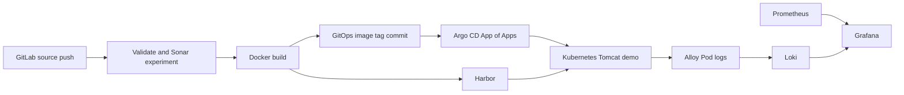

# GitLab GitOps Lab

GitLab CI, Harbor, Argo CD로 컨테이너 빌드와 GitOps 배포를 연결하고, Prometheus·Grafana·Alloy·Loki로 메트릭과 로그를 수집·조회한 **개인 PoC**입니다.

개인 GitLab 프로젝트를 나중에 참고할 용으로 만듬

## 먼저 볼 구현

| 확인할 내용 | 코드 |
|---|---|
| 경로별 pipeline/job 실행 조건, 이미지 빌드와 GitOps 변경 | [.gitlab-ci.yml](.gitlab-ci.yml) |
| App of Apps 진입점과 child Applications | [root](k8s-gitops/root/root-application.yaml), [applications](k8s-gitops/applications) |
| HPA와 GitOps의 replicas 관리 분리 | [Application](k8s-gitops/applications/api-tester-dev.yaml), [Deployment](k8s-gitops/apps/api-tester/base/deployment.yaml), [HPA](k8s-gitops/apps/api-tester/base/hpa.yaml) |
| Pod 로그 탐색·라벨링과 Loki 전송 | [Alloy values](k8s-gitops/addons/logging/alloy/values.yaml) |
| 메트릭·로그 저장 구성 | [Prometheus/Grafana](k8s-gitops/addons/monitoring/kube-prometheus-stack/values.yaml), [Loki](k8s-gitops/addons/logging/loki/values.yaml) |
| Gateway·HTTPRoute 구성 | [Gateway](k8s-gitops/addons/nginx-gateway), [app HTTPRoute](k8s-gitops/apps/api-tester/overlays/dev/httproute.yaml) |

## 구성 흐름

## 직접 구현한 범위

- `api-tester` 변경을 이미지 빌드·Harbor push·dev overlay 태그 갱신으로 연결했습니다. GitLab CI는 Git을 갱신하고 Argo CD가 클러스터 반영을 담당합니다.
- 자동 배포 commit의 제목 패턴을 workflow에서 제외해 pipeline 재생성을 차단했습니다.
- 앱 Deployment에서 replicas를 생략하고 HPA가 개수를 관리하도록 구성했습니다. Argo CD의 `ignoreDifferences`와 `RespectIgnoreDifferences`를 함께 설정했습니다.
- Prometheus/Grafana와 Alloy/Loki의 Helm wrapper chart 및 Argo CD Application을 구성했습니다.
